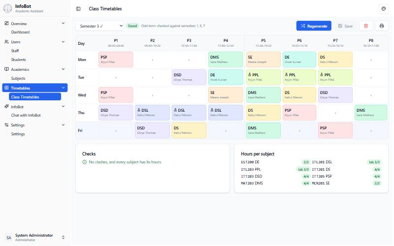
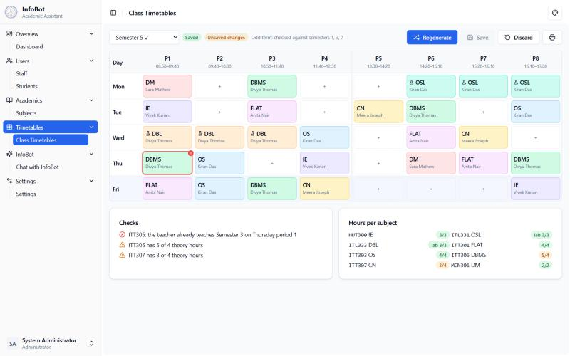
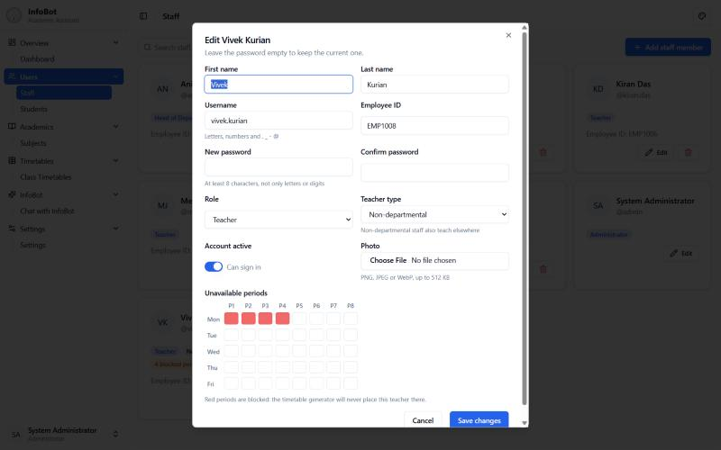
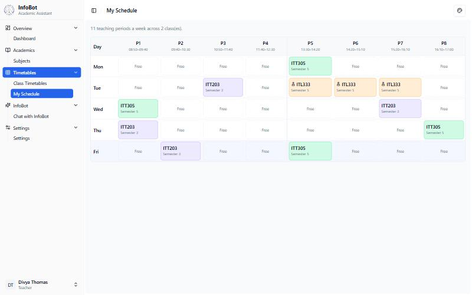
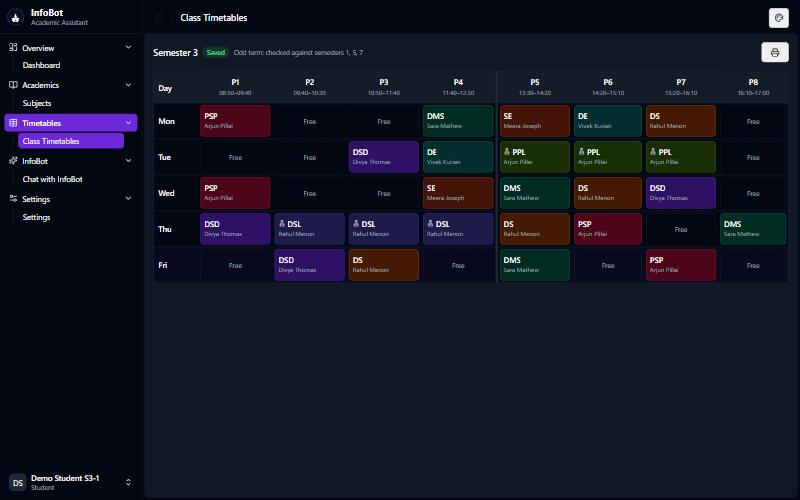
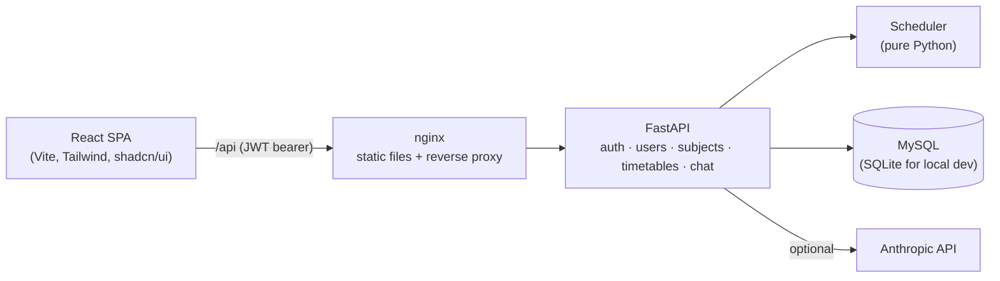

# InfoBot – Academic Timetable Assistant

InfoBot helps an engineering department build **clash-free weekly timetables** for every class, manage staff, students and subjects, and answer timetable questions through a Claude-powered chat assistant.

The core problem: a teacher often teaches several classes. When one class's timetable is built, it must not book that teacher in a period where they already teach another class, or in a period they are unavailable. InfoBot builds each timetable **around every other saved timetable**, checks every manual edit live, and refuses to save a timetable with a clash.



## Features

- **Clash-free timetable generation.** A constraint solver (backtracking search) places theory hours and 3-period lab blocks without double-booking any teacher across classes of the same term.
- **Live conflict checking for manual edits.** Click any period to change it. A clash is outlined in red immediately, explained in plain words, and saving is blocked.
- **Teacher availability.** Mark periods where a teacher (for example one shared with another department) cannot teach. The generator never uses them.
- **Conflict report across all classes.** If a saved timetable later becomes invalid (say a subject gets a new teacher), the dashboard and timetable page flag it.
- **Role-based access.** Admin, Head of Department, Teacher and Student each see only what they should, enforced on the server.
- **Personal views.** Teachers get a combined weekly schedule across all their classes; students see today's classes on their dashboard.
- **Subjects and syllabi.** Lecture/tutorial/practical hours, credits, an assigned teacher, and an optional syllabus PDF.
- **InfoBot chat.** Answers questions using the signed-in user's own subjects and timetable as context. It's optional and turns on when an Anthropic API key is set.
- **Themes.** 8 color themes with light and dark mode, saved per user.

| Clash detection | Teacher availability |
| --- | --- |
|  |  |
| **Teacher's combined schedule** | **Dark mode** |
|  |  |

## How the conflict-free scheduler works

The engine lives in [`backend/app/scheduler.py`](backend/app/scheduler.py). It is pure Python with no database access, so it is fully unit-tested.

1. **Collect what's already taken.** For the class being built, it gathers every teacher's busy periods from the *other* saved timetables in the same term (odd semesters run together, as do even ones), plus each teacher's unavailable periods.
2. **Turn subjects into sessions.** Each theory hour is a 1-period session and each lab is a 3-period block that must sit inside one half-day (it can't span lunch).
3. **Search.** A backtracking search always places the most constrained session next (the one with the fewest legal slots). Identical sessions are placed in increasing order, which removes symmetric duplicates from the search. A light scoring function spreads a subject across the week and avoids back-to-back repeats. A random seed gives a different valid timetable on each *Regenerate*.
4. **Degrade gracefully.** If a perfect timetable is impossible (for example a teacher has fewer free periods than hours to teach), it places everything it can without a clash and reports exactly which hours are missing, instead of silently breaking a rule.
5. **Validate everything.** The same module validates any grid, generated or hand-edited. A teacher clash, an unavailable period or a broken lab block is an **error** and blocks saving. Wrong weekly hours or an overloaded day is a **warning**.

A property-style test generates 30 random curricula with shared teachers and asserts the second class never clashes with the first.

## Architecture



| Layer | Stack |
| --- | --- |
| Frontend | React 19, React Router 7, Vite 6, Tailwind CSS, shadcn/ui (Radix), axios |
| Backend | Python 3.12, FastAPI, SQLAlchemy 2, Pydantic 2, PyJWT, bcrypt |
| Database | MySQL 8 in production, SQLite for development and tests |
| AI | Anthropic Python SDK (Claude) |
| Ops | Docker, docker compose, nginx, GitHub Actions CI |

## Security

This project began as a prototype and was later hardened. The main protections:

- **Every API endpoint requires a valid JWT** (except login and health), and role checks run on the server, not just in the UI.
- **Tokens can be revoked.** Logout and password changes invalidate all earlier tokens (a per-user token version). Tokens expire after 60 minutes by default.
- **Passwords** are hashed with bcrypt and have a minimum strength. Login is rate-limited, and unknown usernames take as long as wrong passwords, so attackers can't use timing to discover usernames.
- **No secret defaults.** The app refuses to start without a strong `SECRET_KEY`, and the first admin comes from environment variables.
- **No sensitive data in responses.** Password hashes and tokens are never returned; API responses use explicit schemas.
- **Safe uploads.** Syllabus PDFs are checked by content (not file name), size-limited, stored under random names, and served only to signed-in users. Profile photos are validated as real PNG/JPEG/WebP images.
- **Privilege boundaries.** A Head of Department can manage teachers and students but not admins. Nobody can delete or demote the last admin.
- **Hardened deployment.** Strict CORS, security headers and a Content-Security-Policy in nginx, a non-root container user, and chat input limits plus rate limiting to control AI costs.

## Run it locally

Requirements: Python 3.12+ and Node 22+.

**Backend**

```bash
cd backend
python -m venv .venv
.venv/Scripts/activate          # Windows; use `source .venv/bin/activate` on macOS/Linux
pip install -r requirements-dev.txt
cp .env.example .env            # then set SECRET_KEY and ADMIN_PASSWORD
python -m app.seed --demo       # optional: fictional staff, students, subjects and timetables
uvicorn app.main:app --reload
```

The API runs at http://localhost:8000, with interactive docs at http://localhost:8000/api/docs.

**Frontend** (in a second terminal)

```bash
cd frontend
npm ci
npm run dev
```

Open http://localhost:5173. Vite forwards `/api` requests to the backend.

## Deploy with Docker

```bash
cp .env.example .env    # fill in SECRET_KEY, MySQL passwords and ADMIN_PASSWORD
docker compose up -d --build
```

The site is served on http://localhost:8080 (change `HTTP_PORT` in `.env`). Put it behind HTTPS (for example a reverse proxy with Let's Encrypt) before using it on the internet, and set `PUBLIC_URL` to the real address. To load demo data into the container:

```bash
docker compose exec backend python -m app.seed --demo
```

## Tests and quality checks

```bash
cd backend && pytest                       # 110 tests: auth, permissions, uploads, scheduler, timetables, chat
cd backend && ruff check app tests
cd frontend && npm run lint && npm run build
```

GitHub Actions runs all of these, plus Docker image builds, on every push and pull request.

## Project structure

```text
backend/
  app/
    main.py          FastAPI app, CORS, security headers
    config.py        settings from environment variables
    models.py        SQLAlchemy models
    schemas.py       request/response validation
    security.py      password hashing, JWT, role dependencies
    scheduler.py     timetable generation and validation (no database access)
    services.py      glue between the database and the scheduler
    seed.py          first admin + demo data
    routers/         auth, users, subjects, timetables, chat
  tests/             pytest suite
frontend/
  src/
    auth/            auth context (current user, login, logout)
    components/      timetable grid, forms, dialogs, shadcn/ui
    pages/           dashboard, staff, students, subjects, timetables, chat, settings
    lib/             API client, navigation, theme and timetable helpers
docker-compose.yml   MySQL + API + nginx
```

## Known limitations

- Rate limits are kept in memory, so the API should run as a single process (it does in the Docker image). Use Redis for several replicas.
- Database tables are created on startup. Schema changes to an existing database would need a migration tool such as Alembic.
- The timetable model has one class per semester (no divisions or rooms yet).

## Author

**Rehen Manoy**, B.Tech Information Technology, Amal Jyothi College of Engineering
